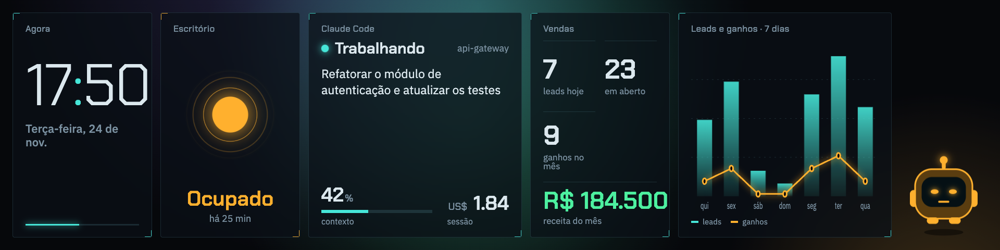
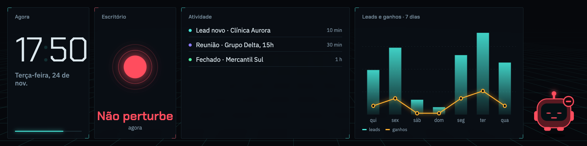
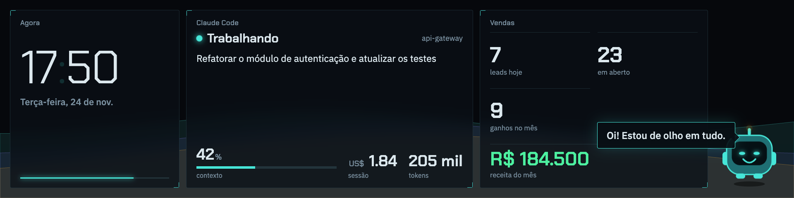
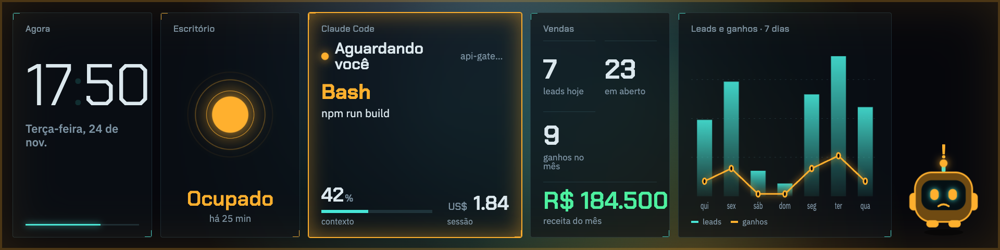
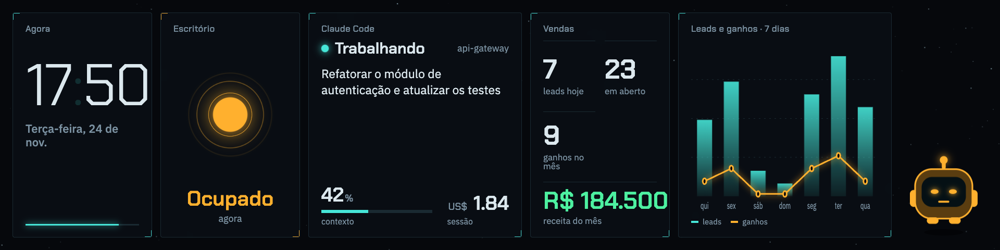
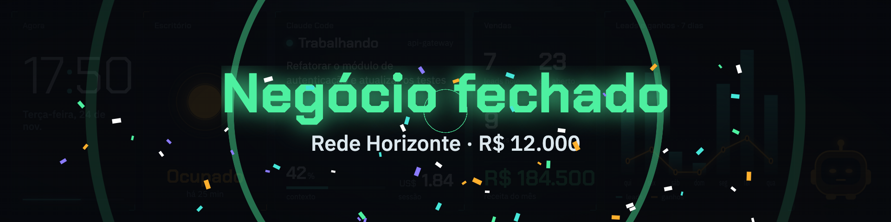
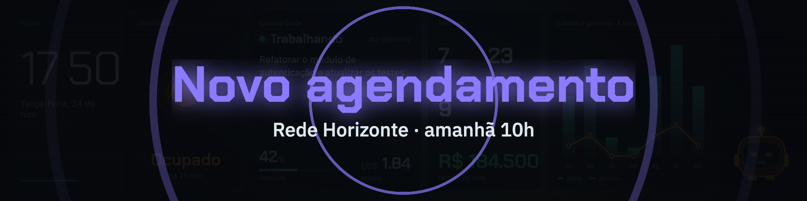
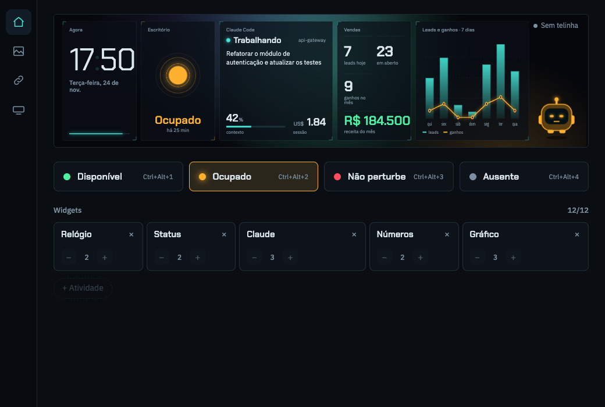

<div align="center">

# Vick Control Center

**Um painel animado para telas-barra 1920×480: status do escritório, Claude Code e Zoho CRM, com um mascote que reage ao seu dia.**



Electron · Preact · TypeScript · Canvas 60 fps · Build Windows feito no macOS

</div>

---

## Por que existe

Telas-barra de 8.8" (1920×480) custam pouco e ficam ótimas ao lado do notebook, mas quase nenhum software sabe usar esse formato. O Vick resolve isso com:

- um **palco fixo de 1920×480**: todo o layout é desenhado nessa resolução e depois escalado (e girado, se a tela vier em pé) para qualquer janela. Assim o encaixe na telinha é sempre exato;
- uma **central de controle** minimalista para trocar status, montar o layout e escolher fundos, sem mexer em código;
- integrações que transformam a telinha num **painel de awareness**: o que o Claude Code está fazendo, se ele precisa de você, e o que acabou de acontecer no CRM.

## Galeria

| | |
|---|---|
|  |  |
| **Não perturbe**: o mascote muda de cor e mostra a placa de proibido enquanto o status durar. | **Layout livre**: widgets com larguras diferentes e o mascote dando um recado. |
|  |  |
| **Claude pedindo aprovação**: borda pulsando, ferramenta em destaque e mascote em alerta. | **Fundo de estrelas** em parallax (um dos cinco fundos animados). |
|  |  |
| **Negócio fechado** no Zoho CRM: animação de tela cheia com confete. | **Novo agendamento** no CRM: anéis expandindo e título em destaque. |

<p align="center"></p>
<p align="center"><i>Central de controle: prévia ao vivo, status com um clique e editor de layout por arrastar.</i></p>

## Recursos

**Dashboard (telinha)**
- Abre sozinho na tela de 1920×480 (ou 480×1920), sem moldura, sem roubar o foco. Sem a telinha, abre uma janela de prévia 4:1.
- Widgets: **Relógio**, **Status do escritório**, **Claude Code**, **Números de vendas**, **Gráfico de 7 dias** e **Atividade** do CRM.
- Fundos animados em canvas (**Aurora, Grade, Chuva, Estrelas, Ondas**) ou **vídeo / GIF / imagem próprios**, com controle de escurecimento.
- **Alertas de tela cheia** para novos agendamentos e negócios fechados.
- **Mascote Vick**: muda de humor conforme o status (disponível, ocupado, não perturbe, ausente) e dá recados curtos ("Claude terminou", "Lead novo…").

**Central de controle**
- Status em um clique ou por **atalho global** `Ctrl+Alt+1..4`, e também pelo ícone da bandeja (que muda de cor).
- Editor de layout em 12 colunas: arraste para reordenar, `−`/`+` para a largura, `×` para remover.
- Integrações com botões de teste para cada alerta.
- Escolha manual da tela e da rotação, além de "Iniciar com o Windows" (sem admin).

## Hardware de referência

| | |
|---|---|
| Tela | Wisecoco 8.8" IPS 1920×480, 60 Hz |
| Conexão | mini-HDMI para o vídeo e USB-C para a alimentação. No Windows aparece como **segunda tela** (modo estendido) |
| Observação | O painel é nativamente em pé (480×1920). Gire para "Paisagem" no Windows ou deixe a **rotação automática** do Vick resolver |
| Dica | Docks e hubs costumam falhar com essa resolução: ligue direto no HDMI ou use um adaptador USB-C→HDMI simples |

Qualquer monitor de 1920×480 funciona, e na aba **Telinha** dá para escolher outra tela manualmente.

## Começando

Requisitos: **Node.js 22+** (há um `.nvmrc`) e npm.

```bash
git clone https://github.com/DjalmaHenry/vick-control-center.git
cd vick-control-center
nvm use        # opcional
npm install
npm run dev
```

Em modo dev abrem a central de controle e uma janela de prévia 960×240 (a mesma tela em 50%). O ícone fica na barra de menu (macOS) ou na bandeja (Windows).

| Script | O que faz |
|---|---|
| `npm run dev` | Desenvolvimento com hot reload |
| `npm run typecheck` | Checagem de tipos |
| `npm run build` | Build de produção em `out/` |
| `npm run dist:win` | Gera `dist/Vick-Control-Center-<versão>-portable.exe` |
| `npm run dist:win:installer` | Gera um instalador NSIS por usuário |

### Gerando o .exe no macOS

O alvo é Windows, mas o build roda no Mac (inclusive Apple Silicon) **sem Wine**: `electron-builder` empacota o Electron x64 com NSIS. O executável é **portable**: basta copiar e abrir, sem admin nem driver.

Limitações conhecidas do cross-build:
- o `.exe` usa o ícone padrão do Electron (editar o ícone do executável exigiria Wine);
- o executável não é assinado, então o SmartScreen pode pedir "Mais informações → Executar assim mesmo".

## Integração com o Claude Code

O Vick sobe um servidor HTTP em `127.0.0.1:47800` e recebe os eventos do Claude Code por **hooks** e pela **statusLine**.

**Instalação automática:** na central, vá em **Integrações → Claude Code → Instalar**. O Vick faz um merge em `~/.claude/settings.json` (guardando um backup em `settings.json.vick-backup`) e só adiciona a `statusLine` se você ainda não tiver uma.

**Instalação manual** (equivalente):

```json
{
  "hooks": {
    "UserPromptSubmit": [{ "hooks": [{ "type": "command", "command": "curl -s -m 2 -X POST -H \"Content-Type: application/json\" --data-binary @- http://127.0.0.1:47800/hook || exit 0" }] }],
    "PermissionRequest": [{ "hooks": [{ "type": "command", "command": "…mesmo comando…" }] }],
    "Notification":      [{ "hooks": [{ "type": "command", "command": "…mesmo comando…" }] }],
    "PostToolUse":       [{ "hooks": [{ "type": "command", "command": "…mesmo comando…" }] }],
    "Stop":              [{ "hooks": [{ "type": "command", "command": "…mesmo comando…" }] }],
    "SessionEnd":        [{ "hooks": [{ "type": "command", "command": "…mesmo comando…" }] }]
  },
  "statusLine": {
    "type": "command",
    "command": "curl -s -m 2 -X POST -H \"Content-Type: application/json\" --data-binary @- http://127.0.0.1:47800/statusline"
  }
}
```

| Evento | Efeito no painel |
|---|---|
| `UserPromptSubmit` | Fase **Trabalhando**; o prompt vira o título da tarefa |
| `PermissionRequest` / `Notification` de permissão | Fase **Aguardando você**, borda âmbar pulsando, mascote em alerta |
| `PostToolUse` | Limpa o pedido de aprovação |
| `Stop` | Fase **Ocioso**; o mascote avisa "Claude terminou" |
| `SessionEnd` | Remove a sessão |
| `statusLine` | Modelo, % de contexto, custo e tokens. A resposta é a linha exibida no Claude (`Opus · 37%`) |

Com várias sessões abertas, o painel mostra a que está pedindo aprovação ou, se nenhuma estiver, a mais recente. O `curl` já vem no Windows 10+ e no macOS, então os hooks não dependem de Node. Se o Vick estiver fechado, os hooks falham em silêncio (`|| exit 0`).

## Integração com o Zoho CRM

O Vick lê **Leads**, **Deals** e **Events** e calcula os números e o gráfico localmente. Ele dispara:
- **Novo agendamento** (Event criado) → alerta violeta de tela cheia;
- **Negócio fechado** (Deal em *Closed Won*) → alerta verde com confete;
- **Lead novo** → recado do mascote.

Sem credenciais, ligue o Zoho e deixe **"Usar dados de demonstração"** ativo para testar o layout e os alertas.

### Obtendo as credenciais (Self Client)

1. Acesse o [Zoho API Console](https://api-console.zoho.com/) da sua região e crie um **Self Client**.
2. Em **Generate Code**, use o escopo
   `ZohoCRM.modules.leads.READ,ZohoCRM.modules.deals.READ,ZohoCRM.modules.events.READ`
   e gere o código (ele vale poucos minutos).
3. Troque o código por um **refresh token**:
   ```bash
   curl -X POST "https://accounts.zoho.com/oauth/v2/token" \
     -d grant_type=authorization_code \
     -d client_id=SEU_CLIENT_ID \
     -d client_secret=SEU_CLIENT_SECRET \
     -d code=CODIGO_GERADO
   ```
   Troque `zoho.com` pelo domínio da sua conta (`eu`, `in`, `com.au`, `jp`, `ca`, `sa`).
4. Na central, em **Integrações → Zoho CRM**, desligue a demonstração, escolha a região, cole Client ID, Client Secret e Refresh token e clique em **Testar conexão**.

As credenciais ficam apenas no arquivo de configuração local (veja abaixo) e nunca vão para o repositório.

## Arquitetura

```
src/
├── main/                 processo principal (Node)
│   ├── index.ts          ciclo de vida, IPC, bandeja, atalhos, protocolo vick-media://
│   ├── store.ts          estado único + persistência em config.json
│   ├── windows.ts        detecção da telinha, janela do dashboard e da central
│   ├── claude.ts         servidor de hooks/statusLine e instalador do settings.json
│   └── zoho.ts           OAuth, polling, cálculo de KPIs, alertas e modo demo
├── preload/index.ts      ponte segura (contextIsolation) exposta como window.vick
├── shared/               tipos e padrões usados nos dois lados
└── renderer/
    ├── common/           Stage, fundos, widgets, mascote e camada de alertas
    ├── dashboard/        página da telinha
    └── control/          página da central de controle
```

```
Claude Code ──hooks/statusLine (curl)──▶ servidor 127.0.0.1:47800 ─┐
Zoho CRM  ◀──────── polling OAuth ───────────── zoho.ts ───────────┤
Atalhos / bandeja / central ──────────────────────────────────────▶ store (main)
                                                                    │ IPC 'state' + 'event'
                                               ┌────────────────────┴───────────────┐
                                          dashboard (telinha)               central (prévia)
```

- **Um estado só**: o processo principal mantém o `AppState` e o transmite para todas as janelas. Os eventos efêmeros (alertas e falas do mascote) seguem num canal separado.
- **Palco fixo** (`Stage.tsx`): o conteúdo vive em 1920×480 e recebe só um `transform`. Por isso a prévia da central é idêntica à telinha.
- **Sem Electron?** Abrindo o build no navegador, o `api.ts` usa um estado simulado, o que ajuda a iterar no visual e a gerar screenshots.

### Onde ficam os dados

| Sistema | Pasta |
|---|---|
| Windows | `%APPDATA%\vick-control-center\` |
| macOS | `~/Library/Application Support/vick-control-center/` |

Dentro dela ficam `config.json` (layout, fundo, integrações) e `media/` (fundos importados).

## Personalizando o código

**Novo widget**
1. Adicione o tipo em `WidgetType` (`src/shared/types.ts`) e a entrada em `WIDGET_META` (`src/shared/defaults.ts`) com nome e larguras mínima e máxima.
2. Crie o componente em `src/renderer/common/widgets/index.tsx` e registre no `switch` do `Widget`.
3. Estilize em `stage.css` pensando em 1920×480: cada coluna tem cerca de 126 px.

**Novo fundo animado**
1. Escreva um `Painter` em `src/renderer/common/Background.tsx`, uma função `(ctx, t, dt) => void` desenhando em 1920×480, e registre em `makers`.
2. Adicione o tipo em `BackgroundKind` e um cartão em `BGS` na central.

**Novo humor do mascote**
Adicione em `MascotMood` e crie as regras `.m-<humor>` em `stage.css`. O SVG expõe `.hull`, `.face`, `.eye`, `.mouth`, `.ear`, `.foot`, `.antenna` e `.bulb`.

## Solução de problemas

| Sintoma | O que fazer |
|---|---|
| A telinha não é detectada | Verifique se o Windows a reconhece como segunda tela em modo **estendido**. Na aba **Telinha**, escolha a tela manualmente. |
| Imagem em pé / de lado | Gire para Paisagem no Windows ou ajuste a **Rotação** (0°, 90°, 270°) na aba Telinha. |
| Tela preta via dock/hub | Ligue direto no HDMI do notebook ou use um adaptador simples. |
| O Claude não aparece | Confira se os hooks estão instalados (Integrações) e se a porta 47800 não está ocupada. |
| Zoho com erro | Use **Testar conexão**. Região errada e refresh token revogado são as causas mais comuns. |
| SmartScreen bloqueia o .exe | "Mais informações → Executar assim mesmo". Em ambientes corporativos, pode ser necessário liberar o app. |

## Roadmap

- [ ] Status automático a partir do calendário e do Teams/Slack
- [ ] Mais widgets do Zoho (funil por etapa, metas)
- [ ] Temas de cor selecionáveis
- [ ] Assinatura de código e ícone próprio no executável

## Contribuindo

Issues e PRs são bem-vindos. Antes de abrir um PR, rode `npm run typecheck` e `npm run build`. Para mudanças visuais, anexe um print em 1920×480.

---

<p align="center">Feito para quem tem uma telinha sobrando ao lado do notebook.</p>
